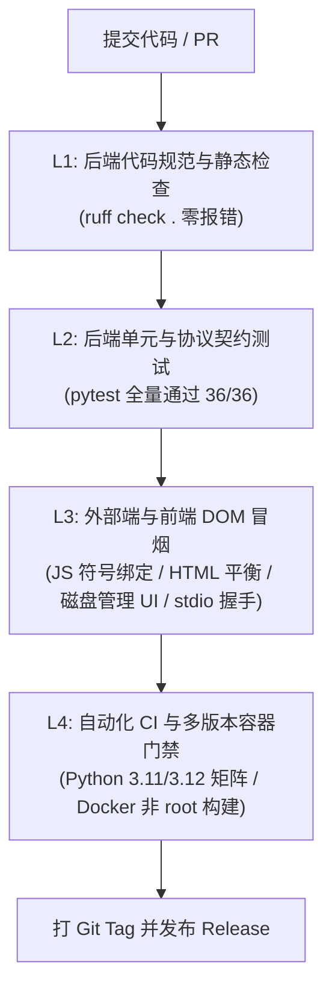

# KHC Image MCP Suite 发版规则说明与质量门禁规范 (RELEASE_SPEC)

> **版本**: v1.0.0 (2026-10-11)  
> **适用项目**: `khc8655/image-mcp` (KHC 多模态图片 MCP 服务与管理控制台)  
> **适用范围**: 所有发版、功能发布、架构重构及生产环境部署。

---

## 零、发布基本原则与核心红线 (Hard Rules)

1. **测试先行，一票否决**：严禁未经完整测试套件验证直接发版。任何门禁不通过，发版流程立即中断。
2. **零敏感凭证泄露**：
   - 严禁提交真实生产 API Key、Admin Token 或私有密码；
   - 严禁包含开发者本地机器绝对路径（如 `/Users/xk/...`）或内网测试域名；
   - 敏感配置文件（`config.json`, `.env*`）必须包含在 `.gitignore` 中。
3. **文档与代码绝对同步**：代码、参数、环境变量变更时，必须同步更新 `README.md` 与 API 文档。
4. **SemVer 语义化版本**：统一采用 `vMAJOR.MINOR.PATCH`（如 `v3.1.0`）。

---

## 一、分层发布测试门禁矩阵 (Tiered Quality Gates)



---

### 门禁一：后端代码规范与静态分析 (Backend L1 Gate)

在 `caddy/mcp-server` 目录下执行：
```bash
ruff check .
```
**强制通过标准**：
- 零 Warning，零 Error；
- 遵循 PEP 8 编码规范，单行最长 140 字符；
- 杜绝未使用死变量、未捕获的语法错误及循环依赖。

---

### 门禁二：后端自动化单元与契约测试 (Backend L2 Gate)

在 `caddy/mcp-server` 目录下执行：
```bash
pytest -v
```
**强制通过项清单 (当前 36 项测试)**：
1. **MCP 2.0.0 协议规范**：
   - `tools/list` 输出符合 JSON Schema，带有 `outputSchema` 与 `readOnlyHint`；
   - 工具入参采用严谨的 `Literal` 枚举；
2. **生图与路由能力**：
   - 显式 `aspect_ratio`（如 `1:1`、`16:9`）不被全局模板或后台默认值覆盖；
   - 局部重绘 `mask` 仅路由至支持蒙版模型，不支持者跳过并记录安全原因；
   - 故障转移与模型降级链路正常，进度事件（`progress`）正确上报；
3. **安全防护边界**：
   - **SSRF 拦截矩阵**：覆盖 `127.0.0.1`、`10.0.0.0/8`、`169.254.169.254`（云元数据）、`100.64.0.0/10`（CGNAT）、`[::ffff:127.0.0.1]`；
   - **下载签名时效**：HMAC 签名下载链接在过期或篡改后返回 `403`；
   - **敏感信息清洗**：上游响应中的 `sk-...`、`Bearer`、内部密钥被自动脱敏；
   - **Token 隔离与限流**：Admin Token 与 Client Token 完全隔离（相同时自锁），多 Client Token 单独 RPM 限流 (429 Retry-After)；
4. **存储管理与修图接口**：
   - `/api/storage/info` 正确统计磁盘占用；
   - `/api/storage/clean` 正确执行缓存释放；
   - `transform_image` 离线修图与 RapidOCR 线程池异步推理正常。

---

### 门禁三：外部端与前端 DOM / 符号门禁 (Frontend & External L3 Gate)

1. **前端版本标识与缓存随动 (Version Badge & Cache Busting)**：
   - **顶部导航栏 Badge 版本号**必须与发版版本绝对一致（`templates/admin.html`、`core.APP_VERSION` 与 `list_models()` 保持单一度量衡），严禁遗留陈旧硬编码版本号导致用户无法确认升级状态；
   - **静态资源导入标签**（`?v=...`）必须随版本号递增，并在服务端 `admin_page` 动态注入带有服务启动时间戳的破坏缓存参数，确保 EdgeOne CDN 与浏览器端破除旧静态缓存。
2. **前端静态符号与死引用排查**：
   - `static/js/` 下所有微模块中的 `window.*` 导出与 HTML 调用一一对应；
   - 严禁调用未定义或遗漏的函数（杜绝运行时 `TypeError`）。
3. **HTML 结构与 DOM 平衡性**：
   - `templates/` 下的所有组件卡片与网格容器必须闭合完整；
   - 动态插入 `?v=...` 破除缓存策略必须生效。
4. **Web 控制台核心交互冒烟**：
   - 控制台登录认证与 Token 校验；
   - 「图片存储与磁盘管理」卡片容量展示、按日分布渲染以及二次确认清理。
5. **外部 Client 契约冒烟**：
   - **Stdio 模式**：`python server.py --stdio` 启动，发送 `tools/list` 秒级握手；
   - **HTTP SSE 模式**：携带 Client Token 调用返回 `resource_link` 签名链接与 384px 缩略图；
   - **主流 Agent**：在 Claude Code、Cursor 等客户端上配置后可正常调用生图与修图。

---

### 门禁四：多环境构建与发布打标 (Packaging & Release L4 Gate)

1. **多 Python 版本矩阵**：
   - GitHub Actions CI 在 `Python 3.11` 与 `Python 3.12` 双版本上全部无报错通过；
2. **Docker 容器规范**：
   - 镜像以非 root 用户 (`app:10001`) 运行；
   - 挂载 `/app/data` 持久化卷测试正常。

---

## 二、发版操作标准流程 (Release SOP)

1. **版本更新 (单一真实源)**：
   - 更新 `core.py` 中的 `APP_VERSION`；
   - 更新 `pyproject.toml` 中的 `version`；
   - 更新 `templates/admin.html` 顶部 Badge 中的版本号；
   - 更新 `static/js/*.js` 中 ESM 模块互相 import 的 `?v=X.X.X` 后缀；
   - 更新 `tools/misc.py` 中 `list_models()` 返回的版本号；
   - 更新 `README.md` 记录变更内容。
2. **门禁验收**：
   - 本地运行 `ruff check .` 与 `pytest -v` 确保 100% 通过；
3. **提交与推送**：
   - 提交代码到 `main` 分支并推送到远端仓库；
   - 观察 GitHub Actions CI 矩阵全部打绿勾 (`✓`)；
4. **Git 打标并发布**：
   ```bash
   git tag -a v3.1.0 -m "Release v3.1.0: P0 bug fixes, security hardening, capabilities expansion, modular refactor, storage UI"
   git push origin v3.1.0
   ```
5. **发布 GitHub Release**：
   - 在 GitHub Releases 页面基于 tag 生成发布记录，附带变更日志。
6. **云端生产环境热更与线上核验**：
   - 同步至云端生产环境并重启；
   - **访问线上控制台并检查顶部导航栏版本号 Badge**，确认与发版版本号完全吻合，杜绝缓存残留与未升级假象。


---

## 三、故障回滚预案 (Rollback Plan)

若发版后生产环境出现未预期异常：
1. **服务降级与回滚**：
   - 本地/远程快速切回上一个稳定 Tag（如 `git checkout v3.0`）；
   - 或通过 systemd 重启上一个版本的服务进程；
2. **数据安全**：
   - `./data/` 目录中的 `config.json` 与 `generated/` 存储独立于代码目录，回滚不会丢失历史配置与已落盘图片。
