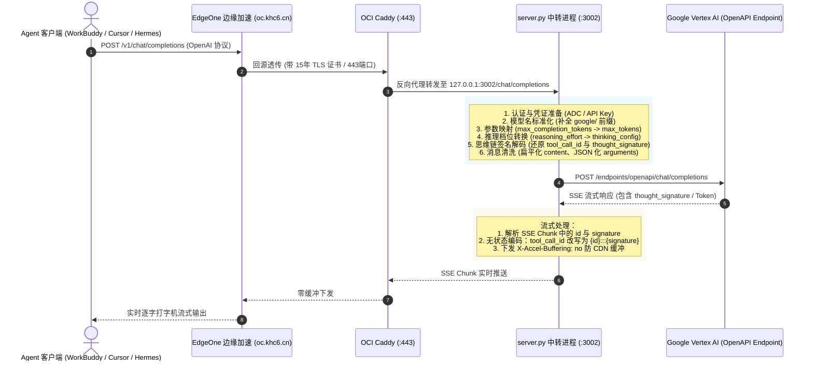

# 📘 Vertex AI OpenAI 兼容中转代理实现原理解析与架构文档

本文档全面梳理并记录了当前系统中 **Vertex AI 文本中转代理（OpenAI-Compatible Chat Completions Proxy）** 的完整实现机制、核心算法、关键协议转换以及在长连接与流式推理中踩过的坑与解决方案。

供后续将文本中转能力迁移至外部网关（如 One-API、New-API 或自定义独立代理）时作为技术参考。

---

## 🗺️ 一、 整体架构与通信流程

代理的核心目标是：**接收标准 OpenAI 格式的请求 (`POST /v1/chat/completions`)，经过参数清洗、模型映射、思维链签名编解码后，转换为 Google Vertex AI OpenAPI 端点所要求的规范并转发；同时处理 SSE 流式推送与错误透明透传。**



---

## 🔑 二、 身份认证与凭证管理 (Authentication)

Google Vertex AI OpenAPI 端点支持两种鉴权形式，中转层实现了**双轨自适应**：

```python
async def get_google_headers(client: httpx.AsyncClient) -> dict:
    headers = {"Content-Type": "application/json"}
    
    # 模式 A: 静态 API Key 鉴权 (优先)
    if API_KEY:
        headers["x-goog-api-key"] = API_KEY
        return headers
        
    # 模式 B: GCP 元数据服务 ADC (Application Default Credentials) 鉴权
    now = time.time()
    if _gcp_token_cache["token"] and now < _gcp_token_cache["expires_at"] - 60:
        headers["Authorization"] = f"Bearer {_gcp_token_cache['token']}"
        return headers
        
    # 动态向 GCP Metadata Server 申请 OAuth 2.0 Access Token
    resp = await client.get(
        "http://metadata.google.internal/computeMetadata/v1/instance/service-accounts/default/token",
        headers={"Metadata-Flavor": "Google"},
        timeout=2.0
    )
    if resp.status_code == 200:
        token_data = resp.json()
        _gcp_token_cache["token"] = token_data.get("access_token")
        _gcp_token_cache["expires_at"] = now + token_data.get("expires_in", 3600)
        headers["Authorization"] = f"Bearer {_gcp_token_cache['token']}"
        return headers
```

* **上游 Target URL 构造规则**：
  * 全局区域 (`LOCATION="global"`): `https://aiplatform.googleapis.com/v1/projects/{PROJECT}/locations/global/endpoints/openapi/chat/completions`
  * 区域节点 (如 `us-central1`): `https://{LOCATION}-aiplatform.googleapis.com/v1/projects/{PROJECT}/locations/{LOCATION}/endpoints/openapi/chat/completions`

---

## 🛠️ 三、 核心协议转换与参数清洗 (Request Transformation)

不同客户端（OpenAI 官方 SDK、LangChain、LlamaIndex、Hermes Agent）发送的请求格式各异，Google Vertex AI 对参数要求极其苛刻。代理层进行了以下标准化清洗：

### 1. 模型前缀标准化
* **逻辑**：客户端常传入 `gemini-3.6-flash` 或 `gemini-2.5-pro`。Vertex AI 必须要求带有 `google/` 前缀。
* **实现**：
  ```python
  model = body.get("model", "")
  if model and not model.startswith("google/"):
      model = "google/" + model
      body["model"] = model
  ```

### 2. Token 限制兼容 (`max_completion_tokens` -> `max_tokens`)
* **逻辑**：新版 OpenAI SDK（针对 o1/o3 推理模型）将参数更名为 `max_completion_tokens`，但 Vertex 端点仅支持标准 `max_tokens`。
* **实现**：
  ```python
  if "max_completion_tokens" in body and "max_tokens" not in body:
      body["max_tokens"] = body["max_completion_tokens"]
      del body["max_completion_tokens"]
  ```

### 3. 推理思考模式转换 (`reasoning_effort` -> `thinking_config`)
* **问题**：客户端直接在顶层传 `reasoning_effort: "high"` 会导致 Google 返回 `400 Invalid Argument`。
* **规则**：
  1. 剥离顶层 `reasoning_effort`。
  2. 识别不同模型版本进行映射：
     * **Gemini 2.5 系列**：仅支持开关 `include_thoughts`（布尔值），不支持档位。
     * **Gemini 3.x 系列 (如 3.6 Flash)**：支持 `thinking_level: "low" | "medium" | "high"`。
* **核心映射代码**：
  ```python
  def build_google_thinking_config(model: str, effort_str: str) -> dict | None:
      if effort_str == "none":
          return {"include_thoughts": False}
      thinking_config = {"include_thoughts": True}
      if m.startswith("gemini-2.5-"):
          return thinking_config  # 仅支持开关
      
      # 映射至 Google 官方标准档位
      if effort_str in {"minimal", "low"}:
          thinking_config["thinking_level"] = "low"
      elif effort_str in {"high", "xhigh"}:
          thinking_config["thinking_level"] = "high"
      else:
          thinking_config["thinking_level"] = "medium"
      return thinking_config

  # 注入到 extra_body.google.thinking_config
  if "reasoning_effort" in body:
      config = build_google_thinking_config(model, str(body["reasoning_effort"]))
      if config:
          body.setdefault("extra_body", {}).setdefault("google", {})["thinking_config"] = config
      del body["reasoning_effort"]
  ```

### 4. 消息体严格清洗 (Message Normalization)
* **防止 Google 报 400 规范**：
  * **Assistant 含有 tool_calls 时**：Google 规定 `msg["content"]` 必须置为 `None`，若包含字符串会导致签名哈希错乱。
  * **Content 扁平化**：部分客户端传 `content: [{"type": "text", "text": "..."}]`，统一解包提取为纯字符串。
  * **Function Arguments 严格 JSON 序列化**：客户端传入的若为 Python 字典，强制 `json.dumps()` 为紧凑字符串。
  * **清理非标扩展字段**：只放行 `ALLOWED_MSG_KEYS = {"role", "content", "tool_calls", "tool_call_id", "name", "extra_content"}`。

---

## 🔐 四、 核心技术突破：`thought_signature` 无状态双向编解码

这是整个 Vertex AI 兼容中转中最关键、也是难度最大的设计。

### 1. 为什么需要它？
* 当开启思考模式时，Gemini 在发起 Tool Call 时会生成一个加密的防篡改签名 `thought_signature`（用于证明思考状态的连续性）。
* 在下一次请求中，**Google 强制要求客户端原样带回 `thought_signature`**，否则直接报 `400 Bad Request: thought_signature is missing`。
* 但标准的 OpenAI SDK / Agent 客户端并没有这个字段，只会将 `tool_call_id` 传回！

### 2. 解决方案：无状态双向编解码协议 (`Stateless Protocol`)

我们在代理层设计了优雅的 `:::` 协议：

```
[Google 返回 Tool Call]
      │
      ▼
代理层将 ID 与签名拼接: tool_call.id = "{real_id}:::{thought_signature}"
      │
      ▼
[标准 OpenAI 客户端接收] (客户端只当这是一个长 ID，完全不破坏任何现有 SDK)
      │
      ▼
[下一轮对话，客户端带回 tool_call_id: "{real_id}:::{thought_signature}"]
      │
      ▼
代理层拦截切割:
  - 真实 ID 还原为: {real_id}
  - 签名重新提取并写入: msg.extra_content.google.thought_signature = {signature}
      │
      ▼
[Google 收到包含原版 thought_signature 的完整多轮请求，校验完美通过！]
```

### 3. 三级兜底保障机制
* **一级（无状态解包）**：通过 `:::` 字符串切分还原。
* **二级（LRU 缓存回查）**：若某些客户端强行截断了 ID，通过 `THOUGHT_SIGNATURE_CACHE = LRUCache(2000)` 映射表回查。
* **三级（跳过校验注入）**：若完全无法找回，注入 `skip_thought_signature_validator`，避免死锁报错。

---

## ⚡ 五、 流式传输 (SSE) 与长连接稳定性保障

针对长文本生成与思考模式（Token 极多、可能耗时数十秒到数分钟）：

1. **解决流式 Chunk 拆包签名丢失 (TCP Packet Breakup)**：
   * 在流式传输中，TCP 分包可能将 `id` 与 `thought_signature` 拆入两个不同的 SSE Chunk。
   * 代理层改进为：即使当前 Chunk 只有 `id` 没有 `signature`，也能自动从 LRU 缓存中异步拉取补全，保障 Tool Call 签名 100% 成功注入。
2. **零响应缓冲 (Zero Buffering)**：
   * Caddy 与代理层下发关键响应头：
     ```http
     X-Accel-Buffering: no
     Cache-Control: no-cache, no-transform
     Connection: keep-alive
     ```
   * 配合 EdgeOne 规则引擎将**回源超时提高至 200 秒**，防止边缘节点在 Gemini 深度思考时误判空闲中断。

---

## 🛡️ 六、 容错与错误透明透传

1. **非流式 5xx 自动重试**：
   * 针对偶发性的 Google 内部 500/502/503 抖动，内置 1 次休眠 1 秒的自动重试。
   * 若重试耗尽仍然 >= 500，直接透传原始 Response 文本与状态码，绝不盲目调用 `.json()` 引发二次崩溃。
2. **429 配额用尽透明透传**：
   * 当触发 Google `RESOURCE_EXHAUSTED` (HTTP 429) 时，完整保留并透传上游 429 状态码与详细 JSON 错误体，使下游 Agent 客户端（如 WorkBuddy）能够准确捕获 429 并触发其内置的模型回退策略。

---

## 📋 七、 总结：迁移到其他中转方案时的核心 Checklist

如果您打算使用其他中转平台（如 One-API / New-API 或独立网关）替换这一部分，请务必确认目标平台是否具备以下核心能力：

- [ ] **是否支持 Vertex AI 的 `thought_signature` 多轮透传**？（许多通用开源网关因缺失此逻辑，导致多轮 Function Calling 必报 400）。
- [ ] **是否支持 `reasoning_effort` 自动转换为 `google.thinking_config`**？
- [ ] **是否支持模型名称自动补齐 `google/` 前缀**？
- [ ] **流式长连接超时是否允许在 120 秒以上**？（若只有默认 15s/30s，复杂推理会频繁卡死）。
- [ ] **是否支持 `max_completion_tokens` 到 `max_tokens` 的参数别名自动重映射**？
